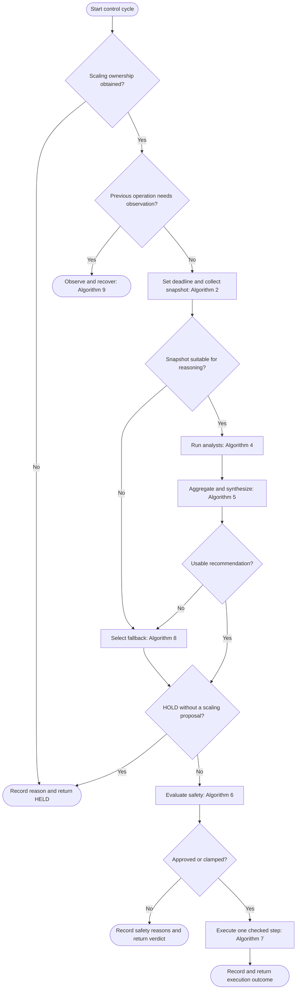
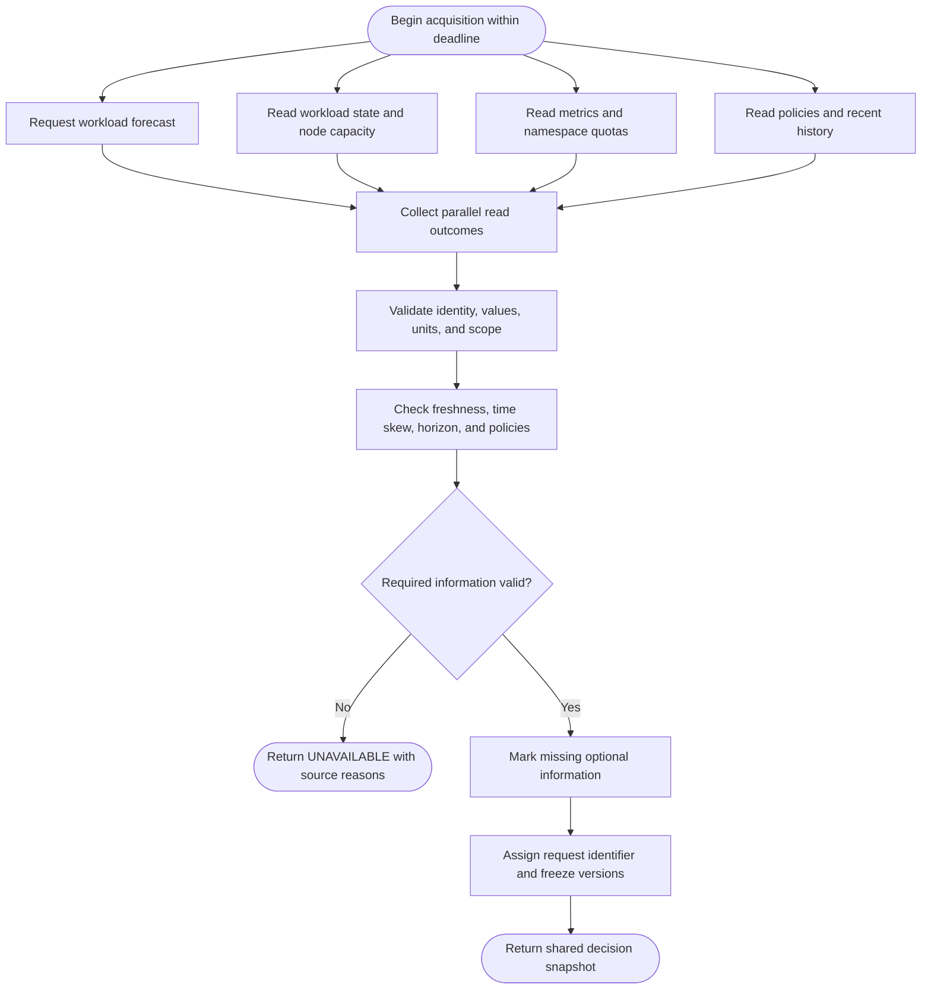
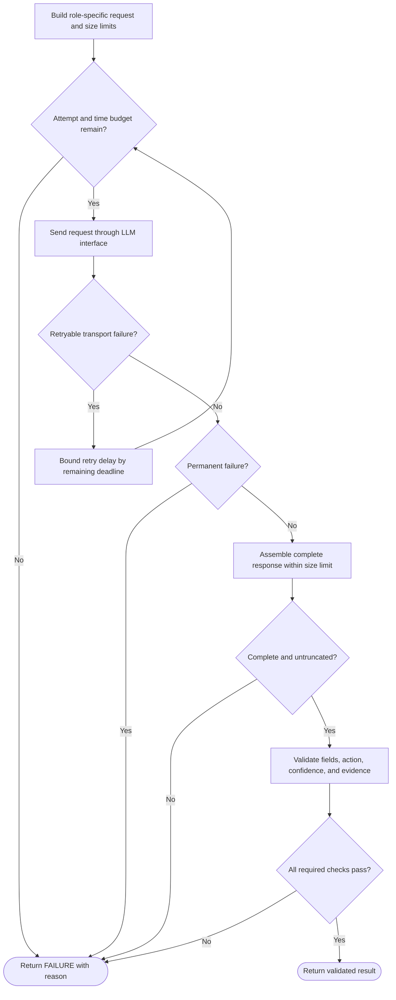
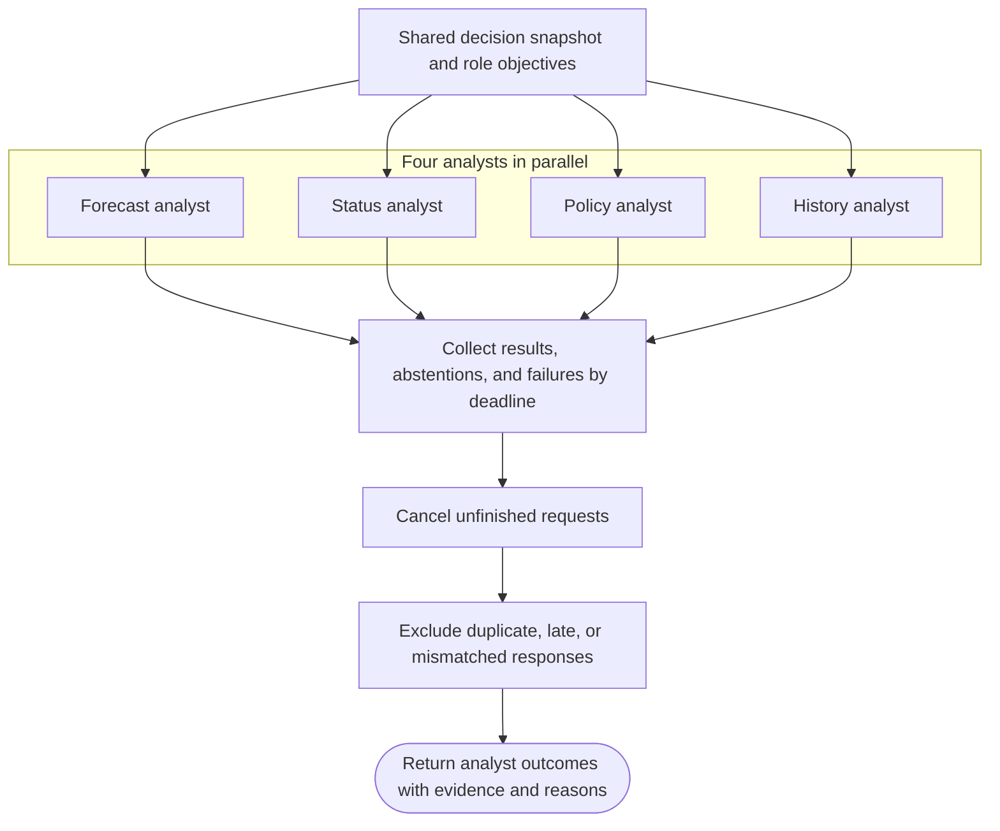
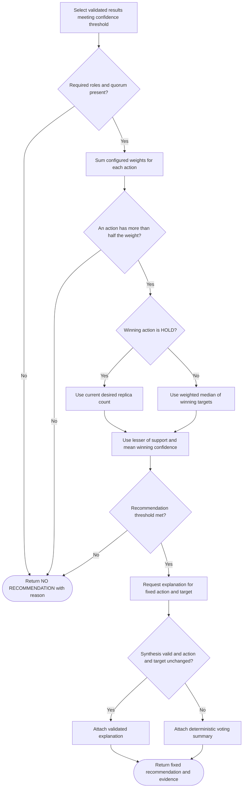
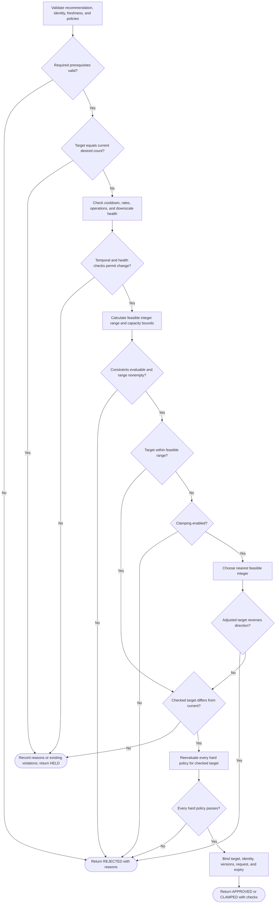
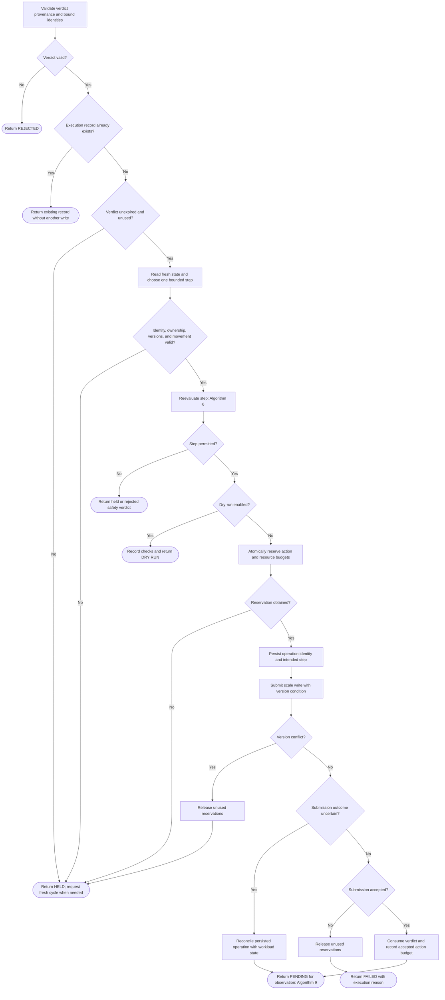
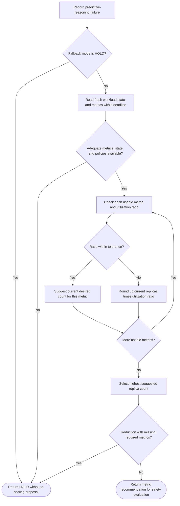
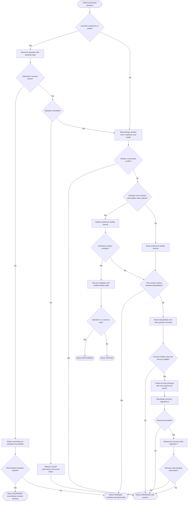
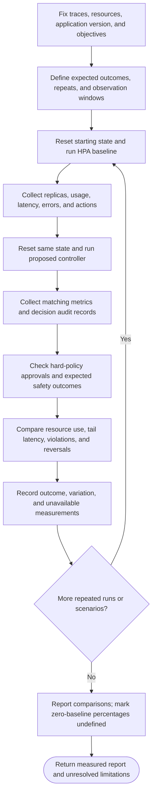

# Algorithms and Pseudocode

This document specifies the proposed autoscaling algorithms described in the
[project proposal](../PROPOSAL_EN.md). It is the starting point for designing the
system before further implementation. Each algorithm pairs a Mermaid flowchart
with language-independent pseudocode. The flowcharts show the main steps and
branches; the pseudocode specifies the detailed checks and outcomes.

The existing services contain simulated behavior and partial message contracts.
The records, checks, and controller behavior below are design requirements;
their presence here does not mean they are already implemented.

## Scope and design choices

The initial design adjusts the replica count of one Kubernetes workload at a
time. Workload forecasting is supplied by an external predictor. The controller
collects forecasts and cluster observations, requests analysis, validates the
recommendation, and applies at most one scaling step per control cycle.

Four analysts run in parallel: forecast, status, policy, and history. The fifth
agent, the synthesizer, receives their results after voting. This staged fanout
is the initial interpretation of the proposal's agent pattern.

The following choices define the initial algorithm and can be evaluated later:

| Choice | Initial rule |
| --- | --- |
| Replica minimum | At least one; scale-to-zero requires a separate design |
| Agent quorum | At least three valid analysts, including forecast and status |
| Voting weights | Equal positive weights initially; configurable per analyst |
| Winning action | Strictly more than half of the valid voting weight |
| Winning target | Weighted median of targets supporting the winning action |
| Missing history | The history analyst abstains |
| Model uncertainty | Confidence thresholds are configured and evaluated |
| Fallback | Hold by default; optionally compute an HPA-style recommendation |
| Execution | One bounded step, followed by observation and a fresh cycle |

Replica bounds, forecast horizon, freshness limits, request deadlines, quorum,
confidence thresholds, step sizes, cooldowns, and stabilization windows are
validated configuration. No threshold in this document is an evaluation result.
All decision stages respect the same cycle deadline. Pending operations use
separate submission-reconciliation and health-observation deadlines.

## Conceptual inputs and outputs

These records describe information the algorithms need, rather than a concrete
API schema.

| Record | Required information |
| --- | --- |
| Workload identity | Cluster, namespace, resource kind, name, and immutable resource identity |
| Forecast | Workload identity, source, generation time, horizon, predicted demand, units, and uncertainty when available |
| Cluster observation | Observation time, resource version, desired and ready replicas, pod health, resource requests, eligible node capacity, namespace quota usage, and current metrics |
| Decision snapshot | Request identifier, workload identity, forecast, observation, business context, policy version, and recent scaling history |
| Analyst result | Analyst role, request identifier, action, integer target, confidence, evidence references, and concise rationale; or an abstention reason |
| Recommendation | Request identifier, action, target, confidence, supporting results, and explanation |
| Safety verdict | Approved, clamped, held, or rejected; checked target, policy version, observation version, expiry, and reasons |
| Execution record | Unique operation identifier, checked step, previous desired count, submission status, observed outcome, and timestamps |

Actions are SCALE UP, SCALE DOWN, and HOLD. Their target must respectively be
greater than, less than, or equal to the snapshot's desired replica count.
Confidence is a score from zero to one, not a measured probability of correctness.

CPU and memory utilization arrive as percentages in the current acquisition
contract. Convert them to fractions only when the source declares a percentage;
retain units and measurement scope. A utilization percentage alone does not
establish how much capacity an additional replica provides. Capacity checks
require resource requests and an explicitly validated workload capacity model.

## Algorithm 1: Autoscaling control cycle

**Input:** Workload identity, validated configuration, active policies, history.

**Output:** Recorded outcome: held, rejected, dry-run, pending, applied, failed,
recovered, or degraded.



```text
ALGORITHM AUTOSCALING CONTROL CYCLE
    Obtain exclusive scaling ownership for the workload
    IF ownership cannot be obtained
        RETURN HELD with an ownership-conflict reason

    IF a previous scaling operation still needs observation
        RETURN OBSERVE AND RECOVER using Algorithm 9

    Set a deadline for this decision cycle
    Collect a decision snapshot using Algorithm 2

    IF the snapshot is unsuitable for predictive reasoning
        Select a fallback using Algorithm 8
    ELSE
        Run the analysis agents using Algorithm 4
        Aggregate their results using Algorithm 5
        IF aggregation produces no usable recommendation
            Select a fallback using Algorithm 8

    IF the selected result is HOLD without a scaling proposal
        Record the reason and any existing policy violations
        RETURN HELD

    Evaluate the selected recommendation using Algorithm 6
    IF the verdict is HELD or REJECTED
        Record the original recommendation and safety reasons
        RETURN the recorded verdict

    Execute one checked scaling step using Algorithm 7
    Record the request, evidence, verdict, and execution outcome
    RETURN the execution outcome
END ALGORITHM
```

Ownership must persist through a pending operation. Release it after completing
the cycle or transfer it through the controller's recovery protocol if the
controller restarts. Every early return records its reason. A dry-run cycle
records its checked step and ends without creating a pending operation.

## Algorithm 2: Collect and validate a decision snapshot

**Input:** Workload identity, forecast horizon, freshness limits, cycle deadline.

**Output:** Predictive snapshot, or an unavailable result with failure reasons.



```text
ALGORITHM COLLECT DECISION SNAPSHOT
    IN PARALLEL, within the acquisition deadline
        Request the workload forecast from the configured predictor
        Read workload state and eligible cluster capacity
        Read current workload metrics and namespace quota usage
        Read active policies and recent decision history
    END PARALLEL

    FOR EACH received observation
        Validate identity, timestamp, units, and measurement scope
        Reject missing, non-finite, or impossible required values
        Normalize declared units while retaining source metadata
    END FOR

    Check observation age and permitted clock skew
    Check that the forecast covers the configured decision horizon
    Check that required observations fall within the allowed time skew
    Check that the workload still has the requested immutable identity
    Check that policy configuration is valid and current

    IF required forecast or cluster information fails validation
        RETURN UNAVAILABLE with the affected sources and reasons

    Mark missing optional history or business context explicitly
    Assign a unique request identifier and capture observation versions
    Freeze the validated inputs as a shared decision snapshot
    RETURN the snapshot
END ALGORITHM
```

A cache is usable only when it satisfies the same identity, horizon, and
freshness rules. Missing information is never replaced with invented metrics.
The parallel reads form a bounded, time-aligned observation rather than an
atomic cluster snapshot; execution therefore reads the state again.

## Algorithm 3: Request and validate an LLM result

**Input:** Agent role, shared snapshot, response requirements, remaining deadline.

**Output:** Validated analyst result or synthesis explanation; otherwise failure.



```text
ALGORITHM REQUEST VALIDATED MODEL RESULT
    Build a role-specific request from the shared snapshot
    Include allowed actions, required fields, units, and evidence identifiers
    Treat telemetry, historical text, and business context as input data
    Assign bounded request size, response size, and total time limits

    FOR EACH permitted attempt while time remains
        Send the request through the configured LLM interface
        IF a retryable transport failure occurs
            Wait a bounded retry delay only if the deadline permits
            CONTINUE to the next attempt
        IF a permanent failure occurs
            RETURN FAILURE with the provider or request reason

        IF a streamed response is used
            Assemble the complete response within the size limit
        Reject incomplete or truncated responses
        Interpret the response as the required conceptual record
        Validate the role, request identifier, action, and integer target
        Validate finite confidence within zero and one
        Check that action and target agree with the snapshot replica count
        Check that cited evidence belongs to the supplied snapshot
        IF any required check fails
            RETURN FAILURE with validation reasons

        RETURN the validated result
    END FOR

    RETURN FAILURE because the attempt or time budget is exhausted
END ALGORITHM
```

The model supplies recommendations and explanations. Policy identifiers,
execution authority, resource identity, and snapshot versions come from the
controller. Stream fragments cannot authorize scaling. Retrying a request
consumes the same cycle budget.

## Algorithm 4: Parallel specialist analysis

**Input:** One shared decision snapshot, configured analyst weights and deadlines.

**Output:** Validated analyst results, abstentions, and failures by role.

| Analyst | Algorithmic responsibility |
| --- | --- |
| Forecast | Assess demand trend, spike timing, uncertainty, and required capacity over the forecast horizon |
| Status | Assess current utilization, ready and pending pods, node capacity, and rollout health |
| Policy | Explain relevant configured limits and feasible choices; provide advisory analysis |
| History | Compare recent outcomes, reversals, and similar workload periods; abstain when evidence is insufficient |



```text
ALGORITHM RUN SPECIALIST ANALYSTS
    Give each analyst the same snapshot and its role-specific objective

    IN PARALLEL, within the shared analysis deadline
        FOR EACH of forecast, status, policy, and history analysts
            IF evidence required by the role is unavailable
                Record an abstention with its reason
            ELSE
                Request a validated result using Algorithm 3
                Record a result or failure under that analyst's role
        END FOR
    END PARALLEL

    Cancel unfinished requests when the deadline expires
    Exclude duplicate, late, or mismatched responses
    Preserve evidence and failure reasons for aggregation and audit
    RETURN the collected analyst outcomes
END ALGORITHM
```

The policy analyst's opinion participates in reasoning. Algorithm 6 determines
whether a target satisfies hard constraints, regardless of analyst agreement.

## Algorithm 5: Weighted voting and synthesis

**Input:** Shared snapshot, analyst outcomes, configured weights, quorum,
confidence thresholds, remaining synthesis deadline.

**Output:** A recommendation, or no usable recommendation with a reason.



```text
ALGORITHM AGGREGATE AND SYNTHESIZE
    Select validated results meeting the analyst confidence threshold
    IF the required roles or configured quorum are missing
        RETURN NO RECOMMENDATION with a quorum reason

    FOR EACH action among SCALE UP, SCALE DOWN, and HOLD
        Sum the configured weights of analysts supporting that action
    END FOR

    Select the action with strictly more than half of valid voting weight
    IF no action satisfies that condition
        RETURN NO RECOMMENDATION with a disagreement reason

    IF the winning action is HOLD
        Set the target to the snapshot's desired replicas
    ELSE
        Sort the winning analysts' targets in ascending order
        Select the first target whose cumulative weight reaches
            at least half of the winning action's weight

    Compute support as winning weight divided by total valid weight
    Compute the weighted mean confidence of the winning analysts
    Set recommendation confidence to the lesser of these two scores
    IF it is below the configured recommendation threshold
        RETURN NO RECOMMENDATION with a low-confidence reason

    Ask the synthesizer to explain the fixed action and target
        using the snapshot, supporting evidence, and disagreements
    Validate the synthesizer response using Algorithm 3
    IF synthesis fails or changes the fixed action or target
        Attach a deterministic summary of votes, evidence, and disagreement
    ELSE
        Attach the validated synthesis explanation

    RETURN the fixed recommendation and its supporting results
END ALGORITHM
```

Weights depend on configured roles, rather than being set by the model. The
support score measures agreement among valid participants; quorum limits the
effect of missing participants. Agreement and self-reported confidence require
empirical evaluation and cannot substitute for safety checks.

## Algorithm 6: Deterministic safety evaluation

**Input:** Recommendation, recent observation, active policies, action history.

**Output:** Approved, clamped, held, or rejected verdict with explicit reasons.



```text
ALGORITHM EVALUATE SCALING SAFETY
    Validate recommendation structure and trusted workload identity
    Validate observation freshness, policy version, and scaling ownership
    IF a required value or policy cannot be evaluated
        RETURN REJECTED with the missing or invalid prerequisite

    Let CURRENT be the observed desired replica count
    Let TARGET be the proposed integer replica count
    IF TARGET equals CURRENT
        Record any existing violations
        RETURN HELD without approving a mutation

    Check cooldown, action count per time window, and replica-change rate
    Check for conflicting operations and unresolved scaling observations
        excluding a terminal parent operation being considered for recovery
    FOR a reduction, check health and downscale stabilization history
    IF a temporal, health, or ownership constraint blocks the change
        RETURN HELD with every applicable blocking reason

    Calculate the maximum integer change permitted this cycle
        by rounding the configured percentage allowance downward
    Build the feasible integer target range from
        configured minimum and maximum replicas
        the permitted change around CURRENT
        required service capacity and application constraints
        eligible node capacity and namespace resource quotas
    Include pending pods, terminating pods, and reserved resources
    IF required capacity or quota information is unavailable
        RETURN REJECTED with the unavailable constraint
    IF the feasible range is empty
        RETURN REJECTED with conflicting constraint reasons

    IF TARGET falls outside the feasible range
        IF deterministic clamping is disabled
            RETURN REJECTED with the violated bounds
        Move TARGET to the nearest feasible integer
        IF the adjusted target reverses the proposed scaling direction
            RETURN REJECTED because clamping changes the action

    IF TARGET equals CURRENT
        RETURN HELD with the constraints that prevented movement

    Evaluate every hard policy again against the adjusted target
    IF any policy fails, including a constraint outside the numeric range
        RETURN REJECTED with the failed policy identifiers

    Bind the verdict to TARGET, workload identity, policy version,
        observation version, request identifier, and a short expiry
    RETURN APPROVED or CLAMPED with the complete check results
END ALGORITHM
```

For percentage limits, a zero integer allowance blocks movement. A minimum
step of one requires an explicit policy choice. Downscale stabilization uses
the highest required target recorded within its configured window; insufficient
history blocks reductions. Capacity estimates use declared resource requests,
placement constraints, and the validated service capacity model. They account
for overlapping old and new pods rather than assuming an immediate release of
resources.

Policy evaluation is deterministic and independent of the LLM. An unknown
policy type or unsupported rule rejects the proposal. HOLD means no scale
write; existing violations remain recorded for recovery or operator handling.

## Algorithm 7: Execute one checked scaling step

**Input:** Safety verdict, execution configuration, workload ownership.

**Output:** Held, rejected, dry-run, pending, or failed execution record.



```text
ALGORITHM EXECUTE CHECKED STEP
    Validate verdict provenance and its bound workload and request identity
    IF that validation fails
        RETURN REJECTED with the invalid-verdict reason
    IF its request already has an execution record
        RETURN that record without submitting another operation
    IF the verdict is expired or already consumed
        RETURN HELD and request a fresh decision cycle

    Read current workload state, policies, capacity, quotas, and history
    IF workload identity, ownership, or policy version has changed
        RETURN HELD and request a fresh decision cycle
    IF desired replicas changed since the approved observation
        RETURN HELD and request a fresh decision cycle

    Calculate the next integer target toward the checked final target
        using the configured gradual-step limit when enabled
    IF rounding permits no movement
        RETURN HELD with a step-limit reason

    Reevaluate the step using Algorithm 6 and the fresh observations
    IF reevaluation does not permit a change
        RETURN the resulting HELD or REJECTED record
    IF dry-run is enabled
        Record the step and every check without submitting it
        RETURN DRY RUN

    Atomically reserve action budget and relevant managed resource budget
    IF the reservation cannot be obtained
        RETURN HELD without submitting an operation
    Persist a unique operation identifier and the intended step
    Submit the desired replica count with an observation-version condition
    IF a version conflict occurs
        Release reservations for the operation that was not submitted
        RETURN HELD and request a fresh decision cycle
    IF the submission outcome is uncertain
        Read workload state and reconcile the persisted operation
        RETURN PENDING until the outcome is resolved
    IF submission definitively fails
        Release reservations for the operation that was not submitted
        RETURN FAILED with the execution reason

    Mark the verdict consumed and record the accepted step
    Retain its action-budget usage in the configured time window
    RETURN PENDING for observation using Algorithm 9
END ALGORITHM
```

The next step is recomputed after observation using a new snapshot. Each actual
mutation consumes cooldown and rate-limit budget, including recovery actions.
If gradual scaling is configured as a percentage of the checked final target,
round that allowance downward and document that base consistently. A successful
API submission means the desired count was accepted; readiness establishes
completion later.

Persisted operations allow restart recovery. An uncertain write must be
reconciled before any retry; equality of replica counts alone is insufficient
to attribute a change to this controller. Reservations cover this controller's
managed operations, while Kubernetes admission remains responsible for its
own cluster-wide constraints.

## Algorithm 8: Select a fallback

**Input:** Failure reason, fallback mode, remaining deadline, current metric sources,
active policies.

**Output:** HOLD or a deterministic metric-based recommendation.



```text
ALGORITHM SELECT FALLBACK
    Record the reason predictive reasoning is unavailable
    IF the configured fallback mode is HOLD
        RETURN HOLD without a scaling proposal

    Obtain fresh workload state and configured utilization metrics
        within the remaining cycle deadline
    IF state, adequate metric coverage, or required policies are unavailable
        RETURN HOLD with the missing prerequisite

    FOR EACH usable configured metric
        Check that current and target utilization use the same basis
        IF its utilization ratio is within the configured tolerance
            Set its suggested count to the current desired replicas
        ELSE
            Set its suggested count to the upward-rounded product of
                current desired replicas and current-to-target utilization
    END FOR

    Select the highest suggested replica count across usable metrics
    IF some required metrics are missing and the result is a reduction
        RETURN HOLD because the reduction has incomplete evidence
    Derive SCALE UP, SCALE DOWN, or HOLD from the suggested count
    RETURN the metric-based recommendation with its evidence and reason
END ALGORITHM
```

This fallback uses the HPA-style utilization ratio as a proposed deterministic
recommendation method. It requires positive target utilization and adequate
ready-pod metric coverage. Algorithm 6 and Algorithm 7 still govern every
fallback mutation; LLM confidence thresholds apply only to model proposals.
The controller retains scaling ownership in this mode. Native HPA takeover
requires a separate ownership and policy-enforcement design.

Fallback safety checks use fresh measured demand and the configured workload
capacity model. A hard policy that specifically requires a valid forecast
blocks fallback scaling when that forecast is unavailable.

## Algorithm 9: Observe scaling and recover when appropriate

**Input:** Pending operation, observation deadline, health criteria, policies.

**Output:** Pending, applied, recovered, or degraded outcome.



```text
ALGORITHM OBSERVE AND RECOVER
    IF submission is uncertain or interrupted by a controller restart
        Reconcile workload state with the persisted operation first
        IF the operation is definitively not submitted
            Release only its unused reservations and record FAILED
            RETURN DEGRADED with the submission reason
        IF the submission outcome is still uncertain
            Retain ownership and reservations; schedule reconciliation
            IF the reconciliation deadline has expired
                RETURN DEGRADED while keeping reconciliation pending
            RETURN PENDING with the uncertainty reason

    Read workload identity, desired and ready replicas, events, and health
    IF the workload was replaced or another owner changed its desired count
        Record the conflict and stop automatic recovery for this operation
        RETURN DEGRADED with the ownership or identity reason

    IF the submitted desired count is reached by healthy ready replicas
        Update the persisted interval of continuously acceptable health
        IF the configured verification window is complete
            Record completion and update the last verified healthy state
            Reconcile resource reservations against actual observations
            IF this operation is a recovery step
                RETURN RECOVERED
            RETURN APPLIED
    ELSE
        Reset the persisted interval of continuously acceptable health

    IF the observation deadline remains and degradation is not sustained
        RETURN PENDING and schedule another observation

    Record failed convergence or sustained health degradation
    Mark the original operation terminal before considering recovery
    Retrieve the previous verified healthy replica count for this workload
    IF no previous healthy state is known, recovery was already attempted,
        or this operation is itself a recovery step
        RETURN DEGRADED with a recovery-unavailable reason

    Build a recovery proposal using the previous healthy count
        with a new request identifier and the failed operation as its parent
    Reevaluate it with current state and current policies using Algorithm 6
    IF recovery is blocked or rejected
        Record the blocking policies and retain the observed state
        RETURN DEGRADED

    Mark the single recovery attempt and execute it using Algorithm 7
    Observe that operation through the same verification process
    IF recovery reaches a verified healthy state
        RETURN RECOVERED
    OTHERWISE
        RETURN PENDING or DEGRADED according to its observation outcome
END ALGORITHM
```

Verification checks ready capacity, pod failures, scheduling events, error rate,
and application latency against configured criteria. Observation runs across
scheduled cycles, with a deadline that includes the verification window.
Uncertain submission prevents additional writes until its outcome is resolved;
exceeding the reconciliation deadline records a degraded outcome and continues
reconciliation while retaining ownership. Restoring a previous replica count
requires current safety approval: quotas, demand, and capacity
may have changed. Recovery is limited to one attempt per failed operation to
avoid repeated reversals. A recovery operation records its parent operation so
that it cannot begin another automatic recovery chain.

## Algorithm 10: Evaluate against an HPA baseline

**Input:** Controlled workload scenarios, comparable cluster setup, evaluation plan.

**Output:** Scenario results, safety outcomes, and measured comparisons.



```text
ALGORITHM EVALUATE AUTOSCALING DESIGN
    Fix workload traces, resource budgets, application version, and objectives
    Define expected safety outcomes before running each scenario
    Choose repeated runs, observation windows, and comparable starting states

    FOR EACH evaluation scenario
        Reset the experiment to its documented starting state
        Run the configured HPA baseline under the scenario's workload
        Collect ready replicas, resource usage, latency, errors, and actions

        Reset to the same documented starting state
        Run the proposed controller under the same workload
        Collect the same measurements plus forecasts, model time and cost,
            recommendations, safety verdicts, fallback events, and recovery

        Check that every submitted mutation passed its active hard policies
        Compare observed safety behavior with the predefined expected outcome
        Compare resource use, tail latency, service violations, and reversals
        Report repeated-run variation and unavailable measurements
        Record expected outcome, observed outcome, and scenario status
    END FOR

    Report improvements or regressions relative to each baseline measurement
    Label percentage comparisons undefined when the baseline value is zero
    RETURN the measured scenario report and unresolved limitations
END ALGORITHM
```

| Scenario | Expected algorithm behavior |
| --- | --- |
| Daily or weekly demand pattern | Use forecast evidence; measure resource use and latency against HPA |
| Sudden load spike | Recommend additional capacity within hard limits; measure readiness delay and service impact |
| Sustained low load | Reduce replicas after health and stabilization checks permit it |
| Alternating short spikes | Apply cooldown and stabilization; measure direction reversals |
| LLM timeout or outage | Finish within the cycle deadline and select the configured fallback |
| Partial agent failure | Continue only with required roles and quorum; otherwise select fallback |
| Invalid or truncated model result | Exclude the result and record the validation reason |
| Out-of-bounds recommendation | Clamp when permitted and recheck all policies; otherwise reject |
| Stale forecast or cluster data | Exclude stale inputs; allow fallback only with sufficient fresh evidence |
| Quota or node-capacity exhaustion | Block changes that fail deterministic capacity checks |
| Concurrent workload change | Detect version or ownership conflict and start a fresh cycle |
| Uncertain API submission or controller restart | Reconcile the persisted operation before another write |
| Failed convergence or sustained degradation | Attempt one currently permitted recovery or retain a degraded outcome |
| Dry-run mode | Record the checked step without applying it |

Resource efficiency is measured using allocated CPU and memory over the same
time interval, alongside observed usage and service quality. Tail latency uses
the same percentile and workload sampling in both runs. A direction reversal
is an opposite scaling action within the configured evaluation window.
Explanation evaluation checks cited evidence, stated action, policy reasons,
and the ability to reconstruct the decision from its audit record.

The proposal's resource-waste and response-time improvement percentages are
research targets. This specification provides no measured performance results
or claim that the current implementation enforces these algorithms.
