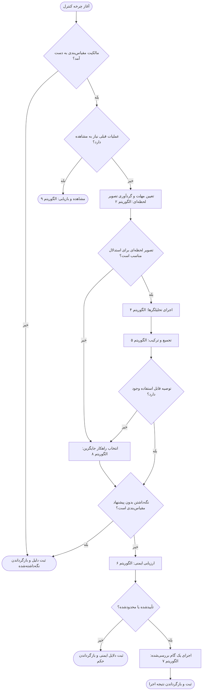
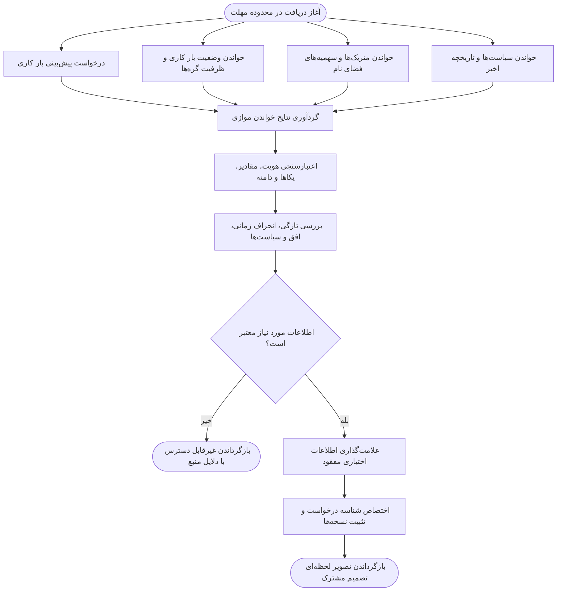
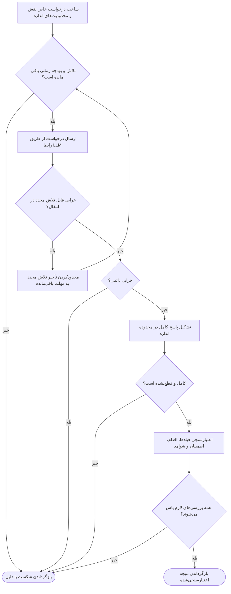
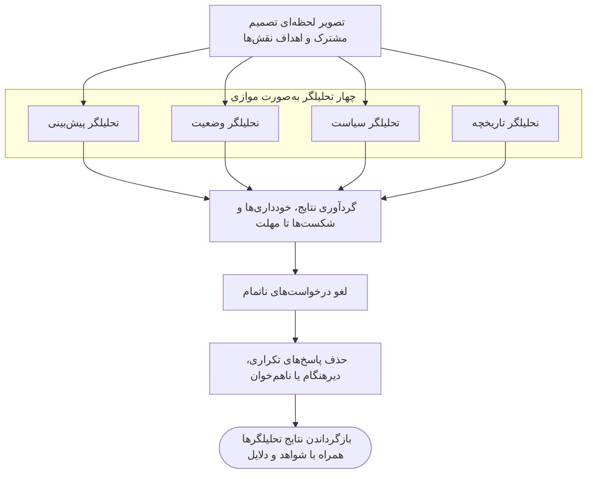
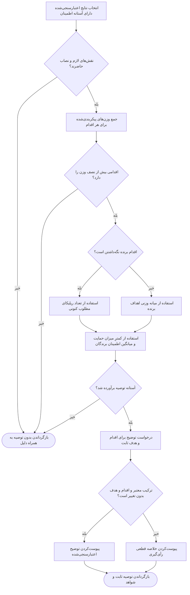
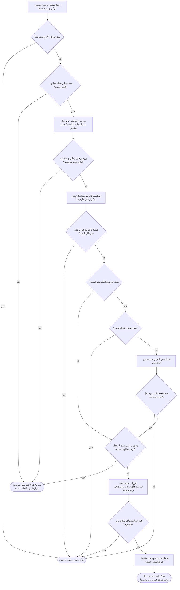
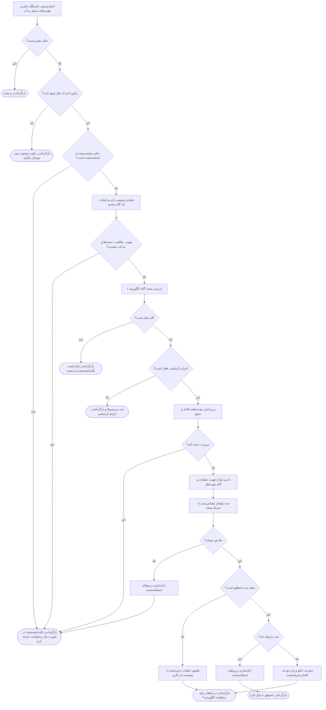
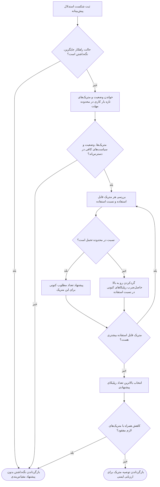
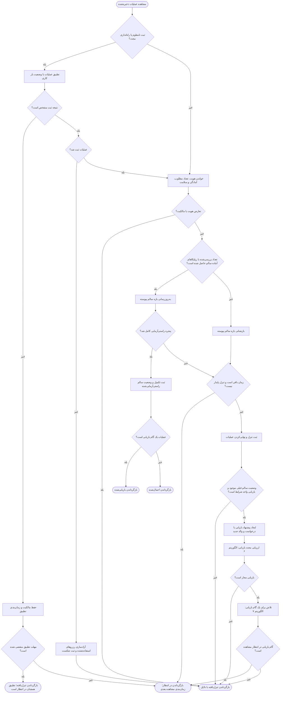
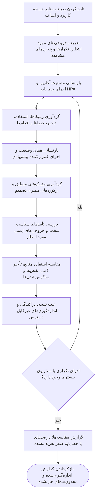

# الگوریتم‌ها و شبه‌کد

این سند، الگوریتم‌های مقیاس‌بندی خودکار پیشنهادی را که در [پروپوزال پروژه](../PROPOSAL_EN.md) توصیف شده‌اند، مشخص می‌کند. این سند نقطه شروع طراحی سامانه پیش از پیاده‌سازی بعدی است. هر الگوریتم، یک فلوچارت Mermaid را با شبه‌کدی مستقل از زبان برنامه‌نویسی ترکیب می‌کند. فلوچارت‌ها گام‌ها و شاخه‌های اصلی را نشان می‌دهند؛ شبه‌کد بررسی‌های جزئی و خروجی‌ها را مشخص می‌کند.

سرویس‌های موجود شامل رفتار شبیه‌سازی‌شده و قراردادهای پیامی ناقص هستند. رکوردها، بررسی‌ها و رفتار کنترل‌کننده در ادامه، الزامات طراحی هستند؛ وجودشان در این سند به معنای پیاده‌سازی‌شدن آن‌ها نیست.

## دامنه و انتخاب‌های طراحی

طراحی اولیه، تعداد رپلیکاهای (replica) یک بار کاری Kubernetes را در هر نوبت تنظیم می‌کند. پیش‌بینی بار کاری توسط یک پیش‌بین بیرونی تأمین می‌شود. کنترل‌کننده، پیش‌بینی‌ها و مشاهدات خوشه را گردآوری می‌کند، تحلیل را درخواست می‌کند، توصیه را اعتبارسنجی می‌کند و در هر چرخه کنترل حداکثر یک گام مقیاس‌بندی اعمال می‌کند.

چهار تحلیلگر به‌صورت موازی اجرا می‌شوند: پیش‌بینی، وضعیت، سیاست و تاریخچه. عامل پنجم، ترکیب‌گر (synthesizer)، پس از رأی‌گیری نتایج آن‌ها را دریافت می‌کند. این فن‌اوت مرحله‌ای (staged fan-out)، تفسیر اولیه الگوی عامل در پروپوزال است.

انتخاب‌های زیر الگوریتم اولیه را تعریف می‌کنند و می‌توانند بعداً ارزیابی شوند:

| انتخاب | قاعده اولیه |
| --- | --- |
| حداقل رپلیکا | دست‌کم یکی؛ مقیاس‌بندی به صفر نیازمند طراحی جداگانه است |
| نصاب عامل‌ها | دست‌کم سه تحلیلگر معتبر، شامل پیش‌بینی و وضعیت |
| وزن‌های رأی‌گیری | در ابتدا وزن‌های مثبت برابر؛ قابل پیکربندی برای هر تحلیلگر |
| اقدام برنده | اکیداً بیش از نیمی از وزن رأی‌گیری معتبر |
| هدف برنده | میانه وزنی اهداف پشتیبان اقدام برنده |
| تاریخچه مفقود | تحلیلگر تاریخچه خودداری می‌کند |
| عدم قطعیت مدل | آستانه‌های اطمینان پیکربندی و ارزیابی می‌شوند |
| راهکار جایگزین (fallback) | به‌طور پیش‌فرض نگه‌داشتن؛ به‌صورت اختیاری محاسبه توصیه‌ای به سبک HPA |
| اجرا | یک گام محدود، و پس از آن مشاهده و چرخه‌ای تازه |

کران‌های رپلیکا، افق پیش‌بینی، محدودیت‌های تازگی، مهلت‌های درخواست، نصاب، آستانه‌های اطمینان، اندازه‌های گام، دوره‌های خنک‌شدن و پنجره‌های تثبیت، پیکربندی اعتبارسنجی‌شده هستند. هیچ آستانه‌ای در این سند نتیجه ارزیابی نیست. همه مراحل تصمیم از یک مهلت چرخه پیروی می‌کنند. عملیات‌های در انتظار از مهلت‌های جداگانه تطبیق ثبت و مشاهده سلامت استفاده می‌کنند.

## ورودی‌ها و خروجی‌های مفهومی

این رکوردها اطلاعات مورد نیاز الگوریتم‌ها را توصیف می‌کنند، نه یک طرح‌واره مشخص از API.

| رکورد | اطلاعات مورد نیاز |
| --- | --- |
| هویت بار کاری | خوشه، فضای نام، نوع منبع، نام و هویت تغییرناپذیر منبع |
| پیش‌بینی | هویت بار کاری، منبع، زمان تولید، افق، تقاضای پیش‌بینی‌شده، یکاها و در صورت وجود، عدم قطعیت |
| مشاهده خوشه | زمان مشاهده، نسخه منبع، رپلیکاهای مطلوب و آماده، سلامت پادها (Pod)، درخواست‌های منابع، ظرفیت گره‌های واجد شرایط، میزان استفاده از سهمیه فضای نام و متریک‌های جاری |
| تصویر لحظه‌ای تصمیم | شناسه درخواست، هویت بار کاری، پیش‌بینی، مشاهده، زمینه کسب‌وکار، نسخه سیاست و تاریخچه اخیر مقیاس‌بندی |
| نتیجه تحلیلگر | نقش تحلیلگر، شناسه درخواست، اقدام، هدف صحیح، اطمینان، ارجاع‌های شواهد و دلیل مختصر؛ یا دلیل خودداری |
| توصیه | شناسه درخواست، اقدام، هدف، اطمینان، نتایج پشتیبان و توضیح |
| حکم ایمنی | تأییدشده، محدودشده (clamped)، نگه‌داشته‌شده یا ردشده؛ هدف بررسی‌شده، نسخه سیاست، نسخه مشاهده، انقضا و دلایل |
| رکورد اجرا | شناسه یکتای عملیات، گام بررسی‌شده، تعداد مطلوب پیشین، وضعیت ثبت، نتیجه مشاهده‌شده و مهرهای زمانی |

اقدام‌ها عبارت‌اند از افزایش مقیاس (SCALE UP)، کاهش مقیاس (SCALE DOWN) و نگه‌داشتن (HOLD). هدف آن‌ها باید به‌ترتیب بزرگ‌تر از، کوچک‌تر از یا برابر با تعداد رپلیکای مطلوب تصویر لحظه‌ای باشد. اطمینان نمره‌ای از صفر تا یک است، نه احتمال اندازه‌گیری‌شده درست بودن.

در قرارداد دریافت فعلی، میزان استفاده از CPU و حافظه به‌صورت درصد وارد می‌شوند. آن‌ها را فقط زمانی به کسر تبدیل کنید که منبع درصدی بودن را اعلام کرده باشد؛ یکاها و دامنه اندازه‌گیری را حفظ کنید. درصد استفاده به‌تنهایی مشخص نمی‌کند که هر رپلیکای اضافی چه میزان ظرفیت فراهم می‌کند. بررسی‌های ظرفیت به درخواست‌های منابع و مدل ظرفیت بار کاری‌ای نیاز دارند که به‌صراحت اعتبارسنجی شده باشد.

## الگوریتم ۱: چرخه کنترل مقیاس‌بندی خودکار

**ورودی:** هویت بار کاری، پیکربندی اعتبارسنجی‌شده، سیاست‌های فعال، تاریخچه.

**خروجی:** نتیجه ثبت‌شده: نگه‌داشته‌شده، ردشده، اجرای آزمایشی (dry-run)، در انتظار، اعمال‌شده، ناموفق، بازیابی‌شده یا تنزل‌یافته.



```text
الگوریتم چرخه کنترل مقیاس‌بندی خودکار
    به دست آوردن مالکیت انحصاری مقیاس‌بندی برای بار کاری
    اگر مالکیت قابل به دست آوردن نباشد
        بازگرداندن نگه‌داشته‌شده با دلیل تعارض مالکیت

    اگر یک عملیات مقیاس‌بندی قبلی همچنان نیاز به مشاهده دارد
        بازگرداندن مشاهده و بازیابی با استفاده از الگوریتم ۹

    تعیین مهلت برای این چرخه تصمیم
    گردآوری تصویر لحظه‌ای تصمیم با استفاده از الگوریتم ۲

    اگر تصویر لحظه‌ای برای استدلال پیش‌بینانه نامناسب باشد
        انتخاب راهکار جایگزین با استفاده از الگوریتم ۸
    در غیر این صورت
        اجرای عامل‌های تحلیل با استفاده از الگوریتم ۴
        تجمیع نتایج آن‌ها با استفاده از الگوریتم ۵
        اگر تجمیع هیچ توصیه قابل استفاده‌ای تولید نکند
            انتخاب راهکار جایگزین با استفاده از الگوریتم ۸

    اگر نتیجه انتخاب‌شده نگه‌داشتن بدون پیشنهاد مقیاس‌بندی باشد
        ثبت دلیل و هر نقض سیاست موجود
        بازگرداندن نگه‌داشته‌شده

    ارزیابی توصیه انتخاب‌شده با استفاده از الگوریتم ۶
    اگر حکم نگه‌داشته‌شده یا ردشده باشد
        ثبت توصیه اصلی و دلایل ایمنی
        بازگرداندن حکم ثبت‌شده

    اجرای یک گام بررسی‌شده مقیاس‌بندی با استفاده از الگوریتم ۷
    ثبت درخواست، شواهد، حکم و نتیجه اجرا
    بازگرداندن نتیجه اجرا
پایان الگوریتم
```

مالکیت باید در طول یک عملیات در انتظار پایدار بماند. آن را پس از تکمیل چرخه آزاد کنید یا در صورت راه‌اندازی مجدد کنترل‌کننده، از طریق پروتکل بازیابی کنترل‌کننده منتقل کنید. هر بازگشت زودهنگام دلیل خود را ثبت می‌کند. یک چرخه اجرای آزمایشی، گام بررسی‌شده خود را ثبت می‌کند و بدون ایجاد عملیات در انتظار پایان می‌یابد.

## الگوریتم ۲: گردآوری و اعتبارسنجی تصویر لحظه‌ای تصمیم

**ورودی:** هویت بار کاری، افق پیش‌بینی، محدودیت‌های تازگی، مهلت چرخه.

**خروجی:** تصویر لحظه‌ای پیش‌بینانه، یا نتیجه‌ای غیرقابل دسترس همراه با دلایل شکست.



```text
الگوریتم گردآوری تصویر لحظه‌ای تصمیم
    به‌صورت موازی، در محدوده مهلت دریافت
        درخواست پیش‌بینی بار کاری از پیش‌بین پیکربندی‌شده
        خواندن وضعیت بار کاری و ظرفیت واجد شرایط خوشه
        خواندن متریک‌های جاری بار کاری و میزان استفاده از سهمیه فضای نام
        خواندن سیاست‌های فعال و تاریخچه اخیر تصمیم‌ها
    پایان موازی

    برای هر مشاهده دریافتی
        اعتبارسنجی هویت، مهر زمانی، یکاها و دامنه اندازه‌گیری
        رد مقادیر لازمِ مفقود، نامتناهی یا ناممکن
        یکسان‌سازی یکاهای اعلام‌شده همراه با حفظ فراداده منبع
    پایان برای

    بررسی عمر مشاهده‌ها و انحراف ساعت مجاز
    بررسی اینکه پیش‌بینی، افق تصمیم پیکربندی‌شده را پوشش می‌دهد
    بررسی قرارگیری مشاهده‌های لازم در محدوده انحراف زمانی مجاز
    بررسی اینکه بار کاری هنوز هویت تغییرناپذیر درخواست‌شده را دارد
    بررسی معتبر و جاری بودن پیکربندی سیاست‌ها

    اگر پیش‌بینی یا اطلاعات لازم خوشه از اعتبارسنجی عبور نکند
        بازگرداندن غیرقابل دسترس به همراه منابع و دلایل آسیب‌دیده

    علامت‌گذاری صریح تاریخچه یا زمینه کسب‌وکار اختیاریِ مفقود
    اختصاص شناسه یکتای درخواست و ثبت نسخه‌های مشاهده
    تثبیت ورودی‌های اعتبارسنجی‌شده به‌عنوان تصویر لحظه‌ای تصمیم مشترک
    بازگرداندن تصویر لحظه‌ای
پایان الگوریتم
```

یک حافظه نهان تنها زمانی قابل استفاده است که همان قواعد هویت، افق و تازگی را برآورده کند. اطلاعات مفقود هرگز با متریک‌های ساختگی جایگزین نمی‌شود. خواندن‌های موازی، مشاهداتی محدود و هم‌راستا از نظر زمانی را شکل می‌دهند، نه یک تصویر لحظه‌ای اتمی از خوشه؛ بنابراین اجرا وضعیت را دوباره می‌خواند.

## الگوریتم ۳: درخواست و اعتبارسنجی نتیجه LLM

**ورودی:** نقش عامل، تصویر لحظه‌ای مشترک، الزامات پاسخ، مهلت باقی‌مانده.

**خروجی:** نتیجه تحلیلگر اعتبارسنجی‌شده یا توضیح ترکیب؛ در غیر این صورت شکست.



```text
الگوریتم درخواست نتیجه اعتبارسنجی‌شده مدل
    ساخت درخواستی خاص نقش از تصویر لحظه‌ای مشترک
    گنجاندن اقدام‌های مجاز، فیلدهای لازم، یکاها و شناسه‌های شواهد
    در نظر گرفتن تله‌متری، متن‌های تاریخی و زمینه کسب‌وکار به‌عنوان داده ورودی
    اختصاص سقف‌های محدود برای اندازه درخواست، اندازه پاسخ و زمان کل

    برای هر تلاش مجاز، تا زمانی که وقت باقی است
        ارسال درخواست از طریق رابط LLM پیکربندی‌شده
        اگر خرابی قابل تلاش مجدد در انتقال رخ دهد
            انتظار به اندازه تأخیر محدود تلاش مجدد، تنها در صورت اجازه دادن مهلت
            ادامه به تلاش بعدی
        اگر خرابی دائمی رخ دهد
            بازگرداندن شکست با دلیل ارائه‌دهنده یا درخواست

        اگر از پاسخ جریانی استفاده شود
            تشکیل پاسخ کامل در محدوده اندازه
        رد پاسخ‌های ناقص یا قطع‌شده
        تفسیر پاسخ به‌عنوان رکورد مفهومی مورد نیاز
        اعتبارسنجی نقش، شناسه درخواست، اقدام و هدف صحیح
        اعتبارسنجی اطمینان متناهی در بازه صفر و یک
        بررسی هم‌خوانی اقدام و هدف با تعداد رپلیکای تصویر لحظه‌ای
        بررسی تعلق شواهد ارجاع‌شده به تصویر لحظه‌ای ارائه‌شده
        اگر هر بررسی لازم شکست بخورد
            بازگرداندن شکست با دلایل اعتبارسنجی

        بازگرداندن نتیجه اعتبارسنجی‌شده
    پایان برای

    بازگرداندن شکست به این دلیل که بودجه تلاش یا زمان تمام شده است
پایان الگوریتم
```

مدل، توصیه‌ها و توضیح‌ها را فراهم می‌کند. شناسه‌های سیاست، اختیار اجرا، هویت منبع و نسخه‌های تصویر لحظه‌ای از کنترل‌کننده می‌آیند. قطعه‌های جریان نمی‌توانند برای مقیاس‌بندی مجوز صادر کنند. تلاش مجدد برای یک درخواست، همان بودجه چرخه را مصرف می‌کند.

## الگوریتم ۴: تحلیل تخصصی موازی

**ورودی:** یک تصویر لحظه‌ای تصمیم مشترک، وزن‌ها و مهلت‌های پیکربندی‌شده تحلیلگرها.

**خروجی:** نتایج اعتبارسنجی‌شده تحلیلگرها، خودداری‌ها و شکست‌ها به تفکیک نقش.

| تحلیلگر | مسئولیت الگوریتمی |
| --- | --- |
| پیش‌بینی | ارزیابی روند تقاضا، زمان‌بندی جهش‌ها، عدم قطعیت و ظرفیت مورد نیاز در طول افق پیش‌بینی |
| وضعیت | ارزیابی میزان استفاده کنونی، پادهای آماده و در انتظار، ظرفیت گره‌ها و سلامت رول‌اوت (rollout) |
| سیاست | توضیح محدودیت‌های پیکربندی‌شده مرتبط و گزینه‌های ممکن؛ ارائه تحلیل مشورتی |
| تاریخچه | مقایسه نتایج اخیر، معکوس‌شدن‌ها و دوره‌های مشابه بار کاری؛ خودداری در صورت ناکافی بودن شواهد |



```text
الگوریتم اجرای تحلیلگرهای تخصصی
    دادن همان تصویر لحظه‌ای و هدف خاص نقش به هر تحلیلگر

    به‌صورت موازی، در محدوده مهلت مشترک تحلیل
        برای هر یک از تحلیلگرهای پیش‌بینی، وضعیت، سیاست و تاریخچه
            اگر شواهد لازم برای آن نقش در دسترس نباشد
                ثبت یک خودداری همراه با دلیل آن
            در غیر این صورت
                درخواست نتیجه اعتبارسنجی‌شده با استفاده از الگوریتم ۳
                ثبت نتیجه یا شکست زیر نقش آن تحلیلگر
        پایان برای
    پایان موازی

    لغو درخواست‌های ناتمام هنگام پایان مهلت
    حذف پاسخ‌های تکراری، دیرهنگام یا ناهم‌خوان
    حفظ شواهد و دلایل شکست برای تجمیع و ممیزی
    بازگرداندن نتایج گردآوری‌شده تحلیلگرها
پایان الگوریتم
```

نظر تحلیلگر سیاست در استدلال مشارکت می‌کند. الگوریتم ۶ فارغ از توافق تحلیلگرها تعیین می‌کند که آیا هدفی قیدهای سخت را برآورده می‌کند یا نه.

## الگوریتم ۵: رأی‌گیری وزنی و ترکیب

**ورودی:** تصویر لحظه‌ای مشترک، نتایج تحلیلگرها، وزن‌های پیکربندی‌شده، نصاب، آستانه‌های اطمینان، مهلت باقی‌مانده ترکیب.

**خروجی:** یک توصیه، یا نبود توصیه قابل استفاده به همراه دلیل.



```text
الگوریتم تجمیع و ترکیب
    انتخاب نتایج اعتبارسنجی‌شده‌ای که آستانه اطمینان تحلیلگر را دارند
    اگر نقش‌های لازم یا نصاب پیکربندی‌شده غایب باشند
        بازگرداندن بدون توصیه با دلیل نصاب

    برای هر اقدام از میان افزایش مقیاس، کاهش مقیاس و نگه‌داشتن
        جمع زدن وزن‌های پیکربندی‌شده تحلیلگرهای حامی آن اقدام
    پایان برای

    انتخاب اقدامی که اکیداً بیش از نیمی از وزن رأی‌گیری معتبر را دارد
    اگر هیچ اقدامی این شرط را برآورده نکند
        بازگرداندن بدون توصیه با دلیل اختلاف

    اگر اقدام برنده نگه‌داشتن باشد
        قرار دادن هدف برابر تعداد رپلیکاهای مطلوب تصویر لحظه‌ای
    در غیر این صورت
        مرتب‌سازی اهداف تحلیلگرهای برنده به ترتیب صعودی
        انتخاب نخستین هدفی که وزن تجمعی آن
            به دست‌کم نصف وزن اقدام برنده برسد

    محاسبه میزان حمایت به‌صورت وزن برنده تقسیم بر کل وزن معتبر
    محاسبه میانگین وزنی اطمینان تحلیلگرهای برنده
    قرار دادن اطمینان توصیه برابر کمترِ این دو نمره
    اگر کمتر از آستانه توصیه پیکربندی‌شده باشد
        بازگرداندن بدون توصیه با دلیل اطمینان پایین

    درخواست از ترکیب‌گر برای توضیح اقدام و هدف ثابت
        با استفاده از تصویر لحظه‌ای، شواهد پشتیبان و اختلاف‌نظرها
    اعتبارسنجی پاسخ ترکیب‌گر با استفاده از الگوریتم ۳
    اگر ترکیب شکست بخورد یا اقدام یا هدف ثابت را تغییر دهد
        پیوست‌کردن خلاصه قطعی رأی‌ها، شواهد و اختلاف‌نظر
    در غیر این صورت
        پیوست‌کردن توضیح ترکیب اعتبارسنجی‌شده

    بازگرداندن توصیه ثابت و نتایج پشتیبان آن
پایان الگوریتم
```

وزن‌ها به نقش‌های پیکربندی‌شده وابسته‌اند، نه اینکه توسط مدل تعیین شوند. نمره حمایت میزان توافق میان مشارکت‌کنندگان معتبر را می‌سنجد؛ نصاب اثر غیبت مشارکت‌کنندگان را محدود می‌کند. توافق و اطمینان خودگزارش‌شده نیازمند ارزیابی تجربی هستند و نمی‌توانند جایگزین بررسی‌های ایمنی شوند.

## الگوریتم ۶: ارزیابی قطعی ایمنی

**ورودی:** توصیه، مشاهده اخیر، سیاست‌های فعال، تاریخچه اقدام‌ها.

**خروجی:** حکم تأییدشده، محدودشده، نگه‌داشته‌شده یا ردشده همراه با دلایل صریح.



```text
الگوریتم ارزیابی ایمنی مقیاس‌بندی
    اعتبارسنجی ساختار توصیه و هویت مورد اعتماد بار کاری
    اعتبارسنجی تازگی مشاهده، نسخه سیاست و مالکیت مقیاس‌بندی
    اگر مقدار یا سیاست لازم قابل ارزیابی نباشد
        بازگرداندن ردشده همراه با پیش‌نیاز مفقود یا نامعتبر

    در نظر گرفتن کنونی (CURRENT) به‌عنوان تعداد رپلیکای مطلوب مشاهده‌شده
    در نظر گرفتن هدف (TARGET) به‌عنوان تعداد رپلیکای صحیح پیشنهادی
    اگر هدف برابر کنونی باشد
        ثبت هر نقض موجود
        بازگرداندن نگه‌داشته‌شده بدون تأیید هیچ تغییری

    بررسی خنک‌شدن، تعداد اقدام‌ها در هر بازه زمانی و نرخ تغییر رپلیکا
    بررسی عملیات‌های متناقض و مشاهدات مقیاس‌بندی حل‌نشده،
        بدون احتساب عملیات والد نهایی‌شده‌ای که برای بازیابی در نظر گرفته شده است
    برای کاهش مقیاس، بررسی سلامت و تاریخچه تثبیت کاهش مقیاس
    اگر قید زمانی، سلامت یا مالکیت مانع تغییر شود
        بازگرداندن نگه‌داشته‌شده همراه با هر دلیل بازدارنده قابل اعمال

    محاسبه بیشترین تغییر صحیح مجاز در این چرخه
        با گردکردن رو به پایین سهم درصدی پیکربندی‌شده
    ساخت بازه هدف صحیح امکان‌پذیر از
        حداقل و حداکثر رپلیکاهای پیکربندی‌شده
        تغییر مجاز حول کنونی
        ظرفیت خدمت لازم و قیدهای کاربردی
        ظرفیت گره‌های واجد شرایط و سهمیه‌های منابع فضای نام
    لحاظ‌کردن پادهای در انتظار، پادهای در حال پایان‌یافتن و منابع رزروشده
    اگر اطلاعات لازم ظرفیت یا سهمیه در دسترس نباشد
        بازگرداندن ردشده همراه با قید غیرقابل دسترس
    اگر بازه امکان‌پذیر خالی باشد
        بازگرداندن ردشده با دلایل تعارض قیدها

    اگر هدف بیرون از بازه امکان‌پذیر قرار گیرد
        اگر محدودسازی قطعی غیرفعال باشد
            بازگرداندن ردشده با کران‌های نقض‌شده
        منتقل کردن هدف به نزدیک‌ترین عدد صحیح امکان‌پذیر
        اگر هدف تعدیل‌شده جهت مقیاس‌بندی پیشنهادی را معکوس کند
            بازگرداندن ردشده به این دلیل که محدودسازی اقدام را تغییر می‌دهد

    اگر هدف برابر کنونی باشد
        بازگرداندن نگه‌داشته‌شده همراه با قیدهایی که مانع حرکت شدند

    ارزیابی مجدد همه سیاست‌های سخت در برابر هدف تعدیل‌شده
    اگر سیاستی شکست بخورد، از جمله قیدی بیرون از بازه عددی
        بازگرداندن ردشده همراه با شناسه سیاست‌های شکست‌خورده

    اتصال حکم به هدف، هویت بار کاری، نسخه سیاست،
        نسخه مشاهده، شناسه درخواست و انقضای کوتاه
    بازگرداندن تأییدشده یا محدودشده همراه با نتایج کامل بررسی‌ها
پایان الگوریتم
```

برای محدودیت‌های درصدی، سهم صحیح صفر مانع حرکت می‌شود. گام حداقلِ یک نیازمند انتخابی صریح در سیاست است. تثبیت کاهش مقیاس از بالاترین هدف مورد نیاز ثبت‌شده در پنجره پیکربندی‌شده آن استفاده می‌کند؛ ناکافی بودن تاریخچه، کاهش‌ها را مسدود می‌کند. برآوردهای ظرفیت از درخواست‌های منابع اعلام‌شده، قیدهای جانمایی و مدل ظرفیت خدمت اعتبارسنجی‌شده استفاده می‌کنند. آن‌ها هم‌پوشانی پادهای قدیمی و جدید را در نظر می‌گیرند، نه آزادسازی فوری منابع را.

ارزیابی سیاست قطعی و مستقل از LLM است. نوع سیاست ناشناخته یا قاعده پشتیبانی‌نشده، پیشنهاد را رد می‌کند. نگه‌داشتن به معنای نبود هیچ نوشتار مقیاس‌بندی است؛ نقض‌های موجود برای بازیابی یا رسیدگی اپراتور ثبت می‌مانند.

## الگوریتم ۷: اجرای یک گام بررسی‌شده مقیاس‌بندی

**ورودی:** حکم ایمنی، پیکربندی اجرا، مالکیت بار کاری.

**خروجی:** رکورد اجرای نگه‌داشته‌شده، ردشده، اجرای آزمایشی، در انتظار یا ناموفق.



```text
الگوریتم اجرای گام بررسی‌شده
    اعتبارسنجی خاستگاه حکم و هویت بار کاری و درخواست متصل به آن
    اگر این اعتبارسنجی شکست بخورد
        بازگرداندن ردشده با دلیل حکم نامعتبر
    اگر درخواست آن از قبل رکورد اجرا داشته باشد
        بازگرداندن همان رکورد بدون ثبت عملیات دیگر
    اگر حکم منقضی یا از قبل مصرف‌شده باشد
        بازگرداندن نگه‌داشته‌شده و درخواست چرخه تصمیم تازه

    خواندن وضعیت جاری بار کاری، سیاست‌ها، ظرفیت، سهمیه‌ها و تاریخچه
    اگر هویت بار کاری، مالکیت یا نسخه سیاست تغییر کرده باشد
        بازگرداندن نگه‌داشته‌شده و درخواست چرخه تصمیم تازه
    اگر تعداد رپلیکاهای مطلوب از زمان مشاهده تأییدشده تغییر کرده باشد
        بازگرداندن نگه‌داشته‌شده و درخواست چرخه تصمیم تازه

    محاسبه هدف صحیح بعدی به سمت هدف نهایی بررسی‌شده
        با استفاده از حد گام تدریجی پیکربندی‌شده در صورت فعال بودن
    اگر گردکردن هیچ حرکتی را ممکن نکند
        بازگرداندن نگه‌داشته‌شده با دلیل حد گام

    ارزیابی مجدد گام با استفاده از الگوریتم ۶ و مشاهدات تازه
    اگر ارزیابی مجدد تغییری را مجاز نشمارد
        بازگرداندن رکورد نگه‌داشته‌شده یا ردشده حاصل
    اگر اجرای آزمایشی فعال باشد
        ثبت گام و همه بررسی‌ها بدون ثبت آن
        بازگرداندن اجرای آزمایشی

    رزرو اتمی بودجه اقدام و بودجه منابع مدیریت‌شده مرتبط
    اگر رزرو به دست نیاید
        بازگرداندن نگه‌داشته‌شده بدون ثبت عملیات
    ذخیره پایدار شناسه یکتای عملیات و گام موردنظر
    ثبت تعداد رپلیکای مطلوب با شرط نسخه مشاهده
    اگر تعارض نسخه رخ دهد
        آزادسازی رزروهای عملیاتی که ثبت نشدند
        بازگرداندن نگه‌داشته‌شده و درخواست چرخه تصمیم تازه
    اگر نتیجه ثبت نامعلوم باشد
        خواندن وضعیت بار کاری و تطبیق عملیات ذخیره‌شده
        بازگرداندن در انتظار تا روشن شدن نتیجه
    اگر ثبت به‌طور قطعی شکست بخورد
        آزادسازی رزروهای عملیاتی که ثبت نشدند
        بازگرداندن ناموفق با دلیل اجرا

    علامت‌گذاری حکم به‌عنوان مصرف‌شده و ثبت گام پذیرفته‌شده
    نگه‌داشتن مصرف بودجه اقدام آن در بازه زمانی پیکربندی‌شده
    بازگرداندن در انتظار برای مشاهده با استفاده از الگوریتم ۹
پایان الگوریتم
```

گام بعدی پس از مشاهده و با استفاده از تصویر لحظه‌ای جدید بازمحاسبه می‌شود. هر تغییر واقعی، بودجه خنک‌شدن و محدودیت نرخ را مصرف می‌کند؛ از جمله اقدام‌های بازیابی. اگر مقیاس‌بندی تدریجی به‌صورت درصدی از هدف نهایی بررسی‌شده پیکربندی شده باشد، آن سهم را رو به پایین گرد کنید و آن پایه را به‌طور سازگار مستند کنید. ثبت موفق در API به معنای پذیرفته‌شدن تعداد مطلوب است؛ آمادگی، تکمیل را بعداً مشخص می‌کند.

عملیات‌های ذخیره‌شده به‌صورت پایدار، بازیابی پس از راه‌اندازی مجدد را ممکن می‌سازند. یک نوشتار نامعلوم باید پیش از هر تلاش مجدد تطبیق شود؛ برابری صرف تعداد رپلیکاها برای انتساب یک تغییر به این کنترل‌کننده کافی نیست. رزروها عملیات مدیریت‌شده این کنترل‌کننده را پوشش می‌دهند، در حالی که پذیرش (admission) در Kubernetes همچنان مسئول قیدهای خود در سطح کل خوشه است.

## الگوریتم ۸: انتخاب راهکار جایگزین

**ورودی:** دلیل شکست، حالت راهکار جایگزین، مهلت باقی‌مانده، منابع متریک جاری، سیاست‌های فعال.

**خروجی:** نگه‌داشتن، یا توصیه قطعی مبتنی بر متریک.



```text
الگوریتم انتخاب راهکار جایگزین
    ثبت دلیل در دسترس نبودن استدلال پیش‌بینانه
    اگر حالت راهکار جایگزین پیکربندی‌شده نگه‌داشتن باشد
        بازگرداندن نگه‌داشتن بدون پیشنهاد مقیاس‌بندی

    به دست آوردن وضعیت تازه بار کاری و متریک‌های استفاده پیکربندی‌شده
        در محدوده مهلت باقی‌مانده چرخه
    اگر وضعیت، پوشش کافی متریک یا سیاست‌های لازم در دسترس نباشند
        بازگرداندن نگه‌داشتن همراه با پیش‌نیاز مفقود

    برای هر متریک قابل استفاده پیکربندی‌شده
        بررسی اینکه میزان استفاده کنونی و هدف از مبنای یکسانی برخوردار باشند
        اگر نسبت استفاده آن در محدوده تحمل پیکربندی‌شده باشد
            قرار دادن تعداد پیشنهادی آن برابر رپلیکاهای مطلوب کنونی
        در غیر این صورت
            قرار دادن تعداد پیشنهادی آن برابر حاصل‌ضرب رپلیکاهای مطلوب کنونی
                در نسبت استفاده کنونی به هدف، گردشده رو به بالا
    پایان برای

    انتخاب بالاترین تعداد رپلیکای پیشنهادی میان متریک‌های قابل استفاده
    اگر برخی متریک‌های لازم مفقود باشند و نتیجه یک کاهش باشد
        بازگرداندن نگه‌داشتن به این دلیل که کاهش شواهد ناقص دارد
    استخراج افزایش مقیاس، کاهش مقیاس یا نگه‌داشتن از تعداد پیشنهادی
    بازگرداندن توصیه مبتنی بر متریک همراه با شواهد و دلیل آن
پایان الگوریتم
```

این راهکار جایگزین، نسبت استفاده به سبک HPA را به‌عنوان روش توصیه قطعی پیشنهادی به کار می‌گیرد. نیازمند هدف استفاده مثبت و پوشش متریک کافی از پادهای آماده است. الگوریتم ۶ و الگوریتم ۷ همچنان بر هر تغییر ناشی از راهکار جایگزین حکم می‌رانند؛ آستانه‌های اطمینان LLM فقط برای پیشنهادهای مدل اعمال می‌شوند. کنترل‌کننده در این حالت مالکیت مقیاس‌بندی را نگه می‌دارد. واگذاری کنترل به HPA بومی نیازمند طراحی جداگانه مالکیت و اعمال سیاست است.

بررسی‌های ایمنی راهکار جایگزین از تقاضای تازه اندازه‌گیری‌شده و مدل ظرفیت بار کاری پیکربندی‌شده استفاده می‌کنند. سیاست سختی که به‌طور خاص به پیش‌بینی معتبر نیاز دارد، مقیاس‌بندی جایگزین را هنگام در دسترس نبودن آن پیش‌بینی مسدود می‌کند.

## الگوریتم ۹: مشاهده مقیاس‌بندی و بازیابی در صورت لزوم

**ورودی:** عملیات در انتظار، مهلت مشاهده، معیارهای سلامت، سیاست‌ها.

**خروجی:** نتیجه در انتظار، اعمال‌شده، بازیابی‌شده یا تنزل‌یافته.



```text
الگوریتم مشاهده و بازیابی
    اگر ثبت نامعلوم باشد یا با راه‌اندازی مجدد کنترل‌کننده قطع شده باشد
        ابتدا تطبیق وضعیت بار کاری با عملیات ذخیره‌شده
        اگر عملیات به‌طور قطعی ثبت نشده باشد
            آزادسازی فقط رزروهای استفاده‌نشده آن و ثبت ناموفق
            بازگرداندن تنزل‌یافته با دلیل ثبت
        اگر نتیجه ثبت همچنان نامعلوم باشد
            حفظ مالکیت و رزروها؛ زمان‌بندی تطبیق
            اگر مهلت تطبیق منقضی شده باشد
                بازگرداندن تنزل‌یافته همراه با حفظ تطبیق در حالت در انتظار
            بازگرداندن در انتظار با دلیل عدم قطعیت

    خواندن هویت بار کاری، رپلیکاهای مطلوب و آماده، رویدادها و سلامت
    اگر بار کاری جایگزین شده باشد یا مالک دیگری تعداد مطلوب آن را تغییر داده باشد
        ثبت تعارض و توقف بازیابی خودکار برای این عملیات
        بازگرداندن تنزل‌یافته با دلیل مالکیت یا هویت

    اگر تعداد مطلوب ثبت‌شده با رپلیکاهای آماده سالم حاصل شده باشد
        به‌روزرسانی بازه ذخیره‌شده سلامت پیوسته قابل قبول
        اگر پنجره راستی‌آزمایی پیکربندی‌شده کامل شده باشد
            ثبت تکمیل و به‌روزرسانی آخرین وضعیت سالم راستی‌آزمایی‌شده
            تطبیق رزروهای منابع با مشاهدات واقعی
            اگر این عملیات یک گام بازیابی باشد
                بازگرداندن بازیابی‌شده
            بازگرداندن اعمال‌شده
    در غیر این صورت
        بازنشانی بازه ذخیره‌شده سلامت پیوسته قابل قبول

    اگر مهلت مشاهده باقی مانده باشد و تنزل پایدار نباشد
        بازگرداندن در انتظار و زمان‌بندی مشاهده دیگر

    ثبت شکست هم‌گرایی یا تنزل پایدار سلامت
    نهایی‌کردن عملیات اصلی پیش از بررسی بازیابی
    به دست آوردن تعداد رپلیکای سالم راستی‌آزمایی‌شده قبلی برای این بار کاری
    اگر وضعیت سالم قبلی معلوم نباشد، بازیابی قبلاً تلاش شده باشد
        یا خود این عملیات یک گام بازیابی باشد
        بازگرداندن تنزل‌یافته با دلیل در دسترس نبودن بازیابی

    ساخت پیشنهاد بازیابی با استفاده از تعداد سالم قبلی
        با شناسه درخواست جدید و عملیات ناموفق به‌عنوان والد آن
    ارزیابی مجدد آن با وضعیت جاری و سیاست‌های جاری با استفاده از الگوریتم ۶
    اگر بازیابی مسدود یا رد شود
        ثبت سیاست‌های بازدارنده و حفظ وضعیت مشاهده‌شده
        بازگرداندن تنزل‌یافته

    علامت‌گذاری تلاش یکتای بازیابی و اجرای آن با استفاده از الگوریتم ۷
    مشاهده آن عملیات از طریق همان فرایند راستی‌آزمایی
    اگر بازیابی به وضعیت سالم راستی‌آزمایی‌شده برسد
        بازگرداندن بازیابی‌شده
    در غیر این صورت
        بازگرداندن در انتظار یا تنزل‌یافته بسته به نتیجه مشاهده آن
پایان الگوریتم
```

راستی‌آزمایی ظرفیت آماده، خرابی پادها، رویدادهای زمان‌بندی، نرخ خطا و تأخیر کاربرد را در برابر معیارهای پیکربندی‌شده بررسی می‌کند. مشاهده در چرخه‌های زمان‌بندی‌شده اجرا می‌شود؛ با مهلتی که پنجره راستی‌آزمایی را در بر می‌گیرد. ثبت نامعلوم تا روشن شدن نتیجه آن مانع نوشتارهای اضافی می‌شود؛ گذشتن از مهلت تطبیق، نتیجه تنزل‌یافته را ثبت می‌کند و تطبیق را همراه با حفظ مالکیت ادامه می‌دهد. بازگرداندن تعداد رپلیکای قبلی نیازمند تأیید ایمنی جاری است: سهمیه‌ها، تقاضا و ظرفیت ممکن است تغییر کرده باشند. بازیابی برای جلوگیری از معکوس‌شدن‌های مکرر، به یک تلاش برای هر عملیات ناموفق محدود می‌شود. عملیات بازیابی، عملیات والد خود را ثبت می‌کند تا نتواند زنجیره بازیابی خودکار دیگری را آغاز کند.

## الگوریتم ۱۰: ارزیابی در برابر خط پایه HPA

**ورودی:** سناریوهای بار کاری کنترل‌شده، راه‌اندازی خوشه قابل مقایسه، طرح ارزیابی.

**خروجی:** نتایج سناریوها، خروجی‌های ایمنی و مقایسه‌های اندازه‌گیری‌شده.



```text
الگوریتم ارزیابی طراحی مقیاس‌بندی خودکار
    ثابت‌کردن ردپاهای بار کاری، بودجه‌های منابع، نسخه کاربرد و اهداف
    تعریف خروجی‌های ایمنی مورد انتظار پیش از اجرای هر سناریو
    انتخاب اجراهای تکراری، پنجره‌های مشاهده و وضعیت‌های آغازین قابل مقایسه

    برای هر سناریوی ارزیابی
        بازنشانی آزمایش به وضعیت آغازین مستندشده آن
        اجرای خط پایه HPA پیکربندی‌شده زیر بار کاری آن سناریو
        گردآوری رپلیکاهای آماده، استفاده منابع، تأخیر، خطاها و اقدام‌ها

        بازنشانی به همان وضعیت آغازین مستندشده
        اجرای کنترل‌کننده پیشنهادی زیر همان بار کاری
        گردآوری همان اندازه‌گیری‌ها به‌علاوه پیش‌بینی‌ها، زمان و هزینه مدل،
            توصیه‌ها، احکام ایمنی، رویدادهای راهکار جایگزین و بازیابی

        بررسی اینکه هر تغییر ثبت‌شده از سیاست‌های سخت فعال خود عبور کرده است
        مقایسه رفتار ایمنی مشاهده‌شده با خروجی مورد انتظار از پیش تعریف‌شده
        مقایسه استفاده منابع، تأخیر دُمی، نقض‌های خدمت و معکوس‌شدن‌ها
        گزارش پراکندگی اجراهای تکراری و اندازه‌گیری‌های غیرقابل دسترس
        ثبت خروجی مورد انتظار، خروجی مشاهده‌شده و وضعیت سناریو
    پایان برای

    گزارش بهبودها یا افت‌ها نسبت به هر اندازه‌گیری خط پایه
    برچسب‌گذاری مقایسه‌های درصدی به‌عنوان تعریف‌نشده هنگام صفر بودن مقدار خط پایه
    بازگرداندن گزارش اندازه‌گیری‌شده سناریوها و محدودیت‌های حل‌نشده
پایان الگوریتم
```

| سناریو | رفتار مورد انتظار الگوریتم |
| --- | --- |
| الگوی تقاضای روزانه یا هفتگی | استفاده از شواهد پیش‌بینی؛ اندازه‌گیری استفاده منابع و تأخیر در برابر HPA |
| جهش ناگهانی بار | توصیه ظرفیت اضافی در محدوده قیدهای سخت؛ اندازه‌گیری تأخیر آمادگی و اثر بر خدمت |
| بار پایین پایدار | کاهش رپلیکاها پس از اجازه بررسی‌های سلامت و تثبیت |
| جهش‌های کوتاه متناوب | اعمال خنک‌شدن و تثبیت؛ اندازه‌گیری معکوس‌شدن‌های جهت |
| اتمام مهلت یا قطعی LLM | پایان در محدوده مهلت چرخه و انتخاب راهکار جایگزین پیکربندی‌شده |
| خرابی جزئی عامل | ادامه تنها با نقش‌های لازم و نصاب؛ در غیر این صورت انتخاب راهکار جایگزین |
| نتیجه مدل نامعتبر یا قطع‌شده | حذف نتیجه و ثبت دلیل اعتبارسنجی |
| توصیه خارج از محدوده | محدودسازی در صورت مجاز بودن و بررسی مجدد همه سیاست‌ها؛ در غیر این صورت رد |
| پیش‌بینی یا داده کهنه خوشه | حذف ورودی‌های کهنه؛ اجازه راهکار جایگزین تنها با شواهد تازه کافی |
| اتمام سهمیه یا ظرفیت گره | مسدودکردن تغییرهایی که بررسی‌های قطعی ظرفیت را شکست می‌دهند |
| تغییر هم‌زمان بار کاری | تشخیص تعارض نسخه یا مالکیت و آغاز چرخه تازه |
| ثبت نامعلوم در API یا راه‌اندازی مجدد کنترل‌کننده | تطبیق عملیات ذخیره‌شده پیش از هر نوشتار دیگر |
| شکست هم‌گرایی یا تنزل پایدار | تلاش برای یک بازیابی که در حال حاضر مجاز است یا نگه‌داشتن نتیجه تنزل‌یافته |
| حالت اجرای آزمایشی | ثبت گام بررسی‌شده بدون اعمال آن |

کارایی منابع با استفاده از CPU و حافظه تخصیص‌یافته در همان بازه زمانی، در کنار استفاده مشاهده‌شده و کیفیت خدمت اندازه‌گیری می‌شود. تأخیر دُمی در هر دو اجرا از همان صدک و نمونه‌برداری بار کاری استفاده می‌کند. معکوس‌شدن جهت، اقدام مقیاس‌بندی مخالف در پنجره ارزیابی پیکربندی‌شده است. ارزیابی توضیح، شواهد ارجاع‌شده، اقدام اعلام‌شده، دلایل سیاست و توانایی بازسازی تصمیم از رکورد ممیزی آن را بررسی می‌کند.

درصدهای بهبود اتلاف منابع و زمان پاسخ‌دهی ذکرشده در پروپوزال، اهداف پژوهشی هستند. این مشخصات هیچ نتیجه عملکردی اندازه‌گیری‌شده یا ادعایی مبنی بر اینکه پیاده‌سازی فعلی این الگوریتم‌ها را اعمال می‌کند، ارائه نمی‌دهد.
